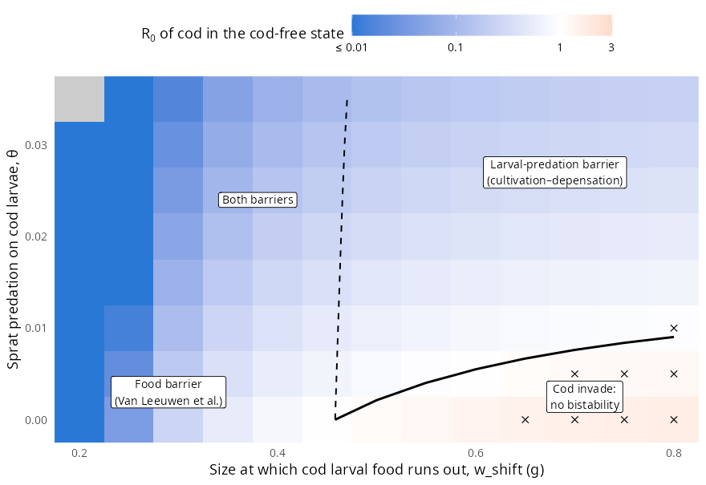
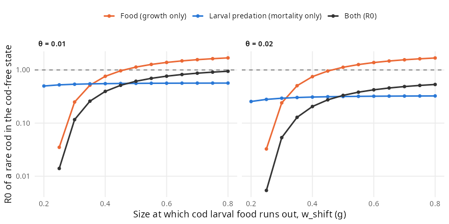
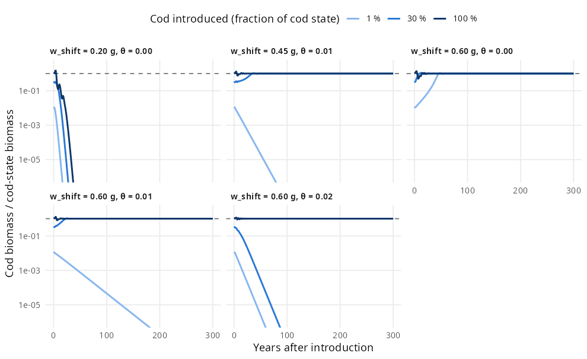

# Prototype: two Allee mechanisms in one mizer model

Two mechanisms have been proposed for why a collapsed cod stock may not
recover, and each has its own mizer model:

* **The emergent Allee effect of Van Leeuwen et al. (2008)**, reproduced in
  this repository. Without cod, sprat become a stunted population that
  produces few young. Juvenile cod then find too few small sprat to grow on.
* **Cultivation–depensation (Walters & Kitchell 2001)**, studied in the
  `cultivation-depensation` repository (`paper.Rmd`). Without cod, abundant
  adult forage fish eat cod eggs and larvae.

This prototype puts both into one model. It is the cod–sprat model of
[`R/build_model.R`](../R/build_model.R) with cod eggs and larvae added, and
with sprat eating them. Two parameters move the model continuously from one
mechanism to the other. Where both are present they reinforce each other.

## The model

[`R/combined_model.R`](../R/combined_model.R) makes three changes to the
cod–sprat model:

* **Cod start as 1 mg eggs** instead of 0.5 g settled juveniles. Their
  energetics (`h`, `ks`) are those of the original model. Mizer would
  otherwise re-derive `h` from the new `w_min` and raise it by 10 %.
* **Cod larvae feed on an unmodelled larval food** that runs out around the
  diet-shift size **`w_shift`**. This is a fixed external encounter rate that
  gives a feeding level of 0.6 on its own, multiplied by
  $1/(1 + (w/w_\text{shift})^6)$. Above `w_shift`, cod depend on sprat as
  before. The larval food is not depleted, so cod larvae do not compete with
  sprat. That keeps the third route of `paper.Rmd`, competition, out of the
  prototype.
* **Sprat eat cod eggs and larvae** with interaction strength **`θ`**
  (`interaction_matrix["Sprat", "Cod"]`). Sprat still do not eat their own
  larvae, and cod do not eat cod. Those are the asymmetries that
  cultivation–depensation needs.

The original model folded cod egg and larval survival into `erepro`. That
survival is now modelled, so cod `erepro` is recalibrated for every
(`w_shift`, `θ`): it is rescaled until the cod state of the original model is
a steady state again, and Newton's method then polishes the state. This works
because with `R_max = Inf` every steady state has R0 = 1, so `erepro` selects
the state. Across the scan, cod biomass stays within 2 % of the original and
`erepro` ranges from 0.0004 to 0.0026. The cod-free state does not depend on
any cod parameter, so it is the original one throughout. This mirrors
`paper.Rmd`, which held its coexistence state (RFP) fixed while varying
parameters.

## Telling the mechanisms apart

Bistability needs a stable cod state and a cod-free state that cod cannot
invade. The cod-free state is uninvadable when the invasion fitness R0 of a
rare cod there is below 1. As in `paper.Rmd`, R0 is decomposed by taking
growth and reproduction from one state and mortality from the other (the cod
state has R0 = 1):

* **food**: cod-free growth and cod-state mortality. This is the
  Van Leeuwen et al. mechanism, and it is below 1 when juvenile cod starve.
* **larval predation**: cod-state growth and cod-free mortality. This is
  cultivation–depensation, and it is below 1 when sprat eat more cod larvae.
* **interaction** = R0 / (food × larval predation). It ranges from 0.42 to 1
  here. It is below 1 because hungry juvenile cod grow slowly, so they spend
  longer in the size range where sprat eat them. The two mechanisms amplify
  each other.

## Results



**R0 of a rare cod in the cod-free state** over the diet-shift size and the
strength of larval predation. The solid line is R0 = 1: below and to the right
of it cod invade, and elsewhere the system is bistable. The dashed line is
where the food factor alone equals 1. × marks a cod state that is unstable,
where it becomes a limit cycle. Grey: no cod state found (see the caveats).

* **Food barrier alone** (θ = 0, `w_shift` < 0.46 g). At `w_shift` = 0.2 g
  the cod state is the original model's: growth of cod stops at about 0.4 g in
  the cod-free state, and R0 = 0. A later diet shift lets juvenile cod reach
  the sizes at which stunted sprat still feed them. The food barrier leaks
  (R0 = 0.04 at 0.25 g, 0.53 at 0.35 g) and fails at 0.46 g.
* **Larval-predation barrier alone** (right of the dashed line, above the
  solid one). Here food works *against* depensation: a rare cod in the
  cod-free state grows *better* than in the cod state (food factor 1.1–1.7).
  This is the situation in `paper.Rmd`. Larval predation alone keeps R0 below
  1.
* **Both barriers** (left of the dashed line, θ > 0). Both factors are below
  1 and multiply.

| `w_shift` | θ | Food | Larval predation | Interaction | **R0** | Cod state (max Re, 1/yr) |
|--:|--:|--:|--:|--:|--:|--:|
| 0.2 g | 0 | 0 | 1 | – | **0** | −0.060 |
| 0.45 g | 0.01 | 0.97 | 0.56 | 0.96 | **0.51** | −0.058 |
| 0.6 g | 0 | 1.39 | 1 | 1 | **1.39** | −0.008 |
| 0.6 g | 0.01 | 1.39 | 0.56 | 0.98 | **0.76** | −0.025 |
| 0.6 g | 0.02 | 1.38 | 0.32 | 0.96 | **0.42** | −0.043 |



**Decomposition along two values of θ.** The larval-predation factor hardly
depends on `w_shift`: it is 0.50–0.57 at θ = 0.01 and 0.26–0.32 at θ = 0.02. The
food factor rises steeply with `w_shift`. Where it crosses 1, the barrier
passes from shared to purely larval predation.



**Cod introduced into the cod-free state** at a fraction of the cod state's
size distribution. The simulations agree with the invasion analysis:

| `w_shift`, θ | 1 % | 30 % | 100 % |
|:--|:--|:--|:--|
| 0.6 g, 0 | invades | establishes | establishes |
| 0.6 g, 0.01 | dies out | establishes | establishes |
| 0.6 g, 0.02 | dies out | dies out | establishes |
| 0.45 g, 0.01 | dies out | establishes | establishes |
| 0.2 g, 0 | dies out | dies out | dies out |

At `w_shift` = 0.6 g, larval predation creates the bistability that food alone
no longer provides, and the Allee threshold rises with θ. The decline rates of
the 1 % seeds match R0 with a cod generation time of about 5 years.

## Caveats

* **A fold near θ ≈ 0.04.** As larval predation strengthens, the Allee
  threshold moves up to meet the cod state. At `w_shift` = 0.6 g a real
  eigenvalue rises from −0.085/yr at θ = 0.038 to −0.0001/yr at θ = 0.040.
  Beyond that, the cod state of the original model can no longer be held
  fixed by recalibrating `erepro`, so the scan stops at θ = 0.035. At
  `w_shift` = 0.2 g Newton's method already fails at θ = 0.035 (grey cell).
* **Small basins.** Explicit larvae halve the damping of the cod state
  (−0.06/yr against −0.13/yr in the original model). At `w_shift` = 0.2 g even
  an introduction of 100 % overshoots, crashes and dies out, although the cod
  state is locally stable. At strong larval predation (θ ≥ 0.035), projecting
  from the copied-in starting state collapses cod even where Newton's method
  finds a stable cod state. So stability is checked with Newton's method and
  `getStability()`, not by projection.
* **Cycles at late diet shifts.** Without larval predation, the cod state
  cycles for `w_shift` ≥ 0.65 g. Larval predation of θ ≥ 0.01–0.015
  stabilises it again. At `w_shift` = 0.2 g, by contrast, larval predation
  weakens the stability (−0.017/yr at θ = 0.02).
* **What sprat eat.** Sprat use their planktivore kernel (β = 1000) on cod
  larvae, so they hit eggs and the smallest larvae hardest. Juvenile sprat,
  which are more numerous in the cod state, eat cod eggs too. This partly
  offsets the effect of the adults.
* **Simplifications.** The larval food of cod is fixed, so the competition
  route is left out. The recalibrated `erepro` ties every point to the
  original cod state. The numerics are those of the original model: upwind
  scheme, 150 size classes, no physical size diffusion.

## Possible next steps

* Fishing scenarios in the combined model: does larval predation change the
  collapse threshold and the hysteresis of the original model?
* Sensitivity to sprat cannibalism, which removes the barrier in `paper.Rmd`
  above θ_For,For ≈ 0.12.
* Competition: let cod larvae eat the plankton spectrum instead of a fixed
  larval food.
* The second-order scheme with physical size diffusion, as in `paper.Rmd`.

## Reproducing

```bash
Rscript combined/run_prototype.R
```

It takes about 10 minutes on 8 cores and writes `results.rds` and the three
figures to this folder. It was computed with mizer 3.4.0.9001 and reads the
two states of the original model from `model/`.
