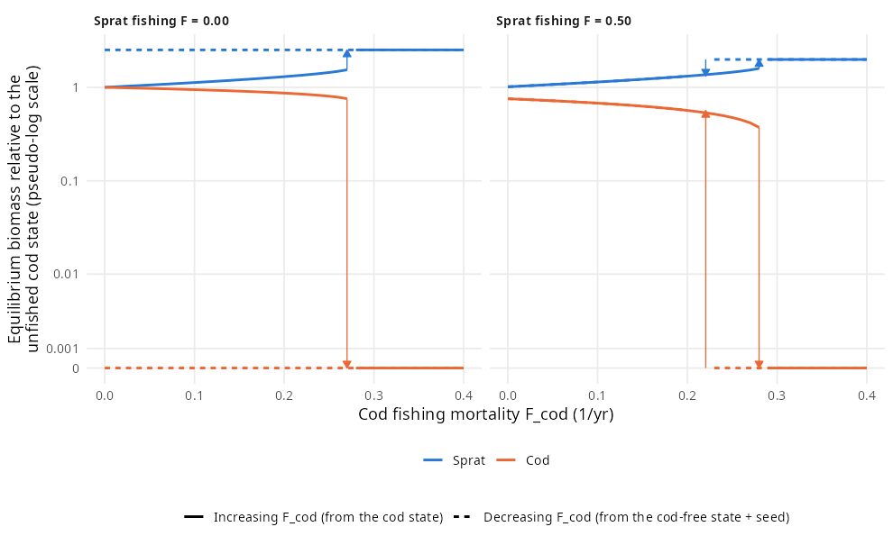

# Prototype: two Allee mechanisms in one mizer model

Two mechanisms have been proposed for why a collapsed cod stock may not
recover, and each has its own mizer model:

* **The emergent Allee effect of Van Leeuwen et al. (2008)**, reproduced in
  this repository. Without cod, sprat become a stunted population that
  produces few young. Juvenile cod then find too few small sprat to grow on.
* **Cultivation–depensation (Walters & Kitchell 2001)**, studied in the
  `cultivation-depensation` repository (`paper.Rmd`). Without cod, abundant
  adult forage fish eat cod eggs and larvae.

This prototype puts both into one model. It is the cod–sprat model of
[`R/build_model.R`](../R/build_model.R) with cod eggs and larvae added, and
with sprat eating them. Two parameters move the model continuously from one
mechanism to the other. Where both are present they reinforce each other.

## The model

[`R/combined_model.R`](../R/combined_model.R) makes three changes to the
cod–sprat model:

* **Cod start as 1 mg eggs** instead of 0.5 g settled juveniles. Their
  energetics (`h`, `ks`) are those of the original model. Mizer would
  otherwise re-derive `h` from the new `w_min` and raise it by 10 %.
* **Cod larvae feed on an unmodelled larval food** that runs out around the
  diet-shift size **`w_shift`**. This is a fixed external encounter rate that
  gives a feeding level of 0.6 on its own, multiplied by
  $1/(1 + (w/w_\text{shift})^6)$. Above `w_shift`, cod depend on sprat as
  before. The larval food is not depleted, so cod larvae do not compete with
  sprat. That keeps the third route of `paper.Rmd`, competition, out of the
  prototype.
* **Sprat eat cod eggs and larvae** with interaction strength **`θ`**
  (`interaction_matrix["Sprat", "Cod"]`). Sprat still do not eat their own
  larvae, and cod do not eat cod. Those are the asymmetries that
  cultivation–depensation needs.

### Numerics

The numerics follow `paper.Rmd`, not the original model:

* **Second-order scheme.** 320 size classes (Δ ln w = 0.053), a centred flux
  and bin-averaged rates. The larval food and the senescence mortality are
  bin-averaged by hand.
* **Size diffusion** D(w) = D_ext w^(n+1), with D_ext = c (α f0 h − ks) and
  c = 0.1. A juvenile cohort feeding at f0 = 0.6 then gains 0.1 in the
  variance of ln w per unit of ln w it grows. Since c > Δ ln w, the centred
  flux stays monotone.
* **Senescence.** Species grids reach 2 w_inf, and a senescence mortality
  0.5 (w/w_inf)^10 stops diffusion carrying adults beyond w_inf.
* **Time stepping.** Projections use TR-BDF2 with Δt = 0.1 yr. Steady states
  come from mizer's Newton solver and stability from `getStability()`.
* **R0** comes from the steady state of the discretised transport equation
  itself (`cod_R0()`, ported from `R0_from_rates()` in `paper.Rmd`'s
  repository). The upwind recursion of this repository's `getR0()` is not
  valid with diffusion.

### Anchor states and `erepro`

The two states of the original model (upwind, cod from 0.5 g) are
interpolated onto the new grid, with cod eggs and larvae filled in. They are
then solved again under the new numerics at the baseline: `w_shift` = 0.2 g
and no larval predation (`combined_anchor()`).

The original model folded cod egg and larval survival into `erepro`. That
survival is now modelled, so cod `erepro` is recalibrated for every
(`w_shift`, `θ`): it is rescaled until the anchor cod state is a steady state,
and Newton's method then polishes it. This works because with `R_max = Inf`
every steady state has R0 = 1, so `erepro` selects the state. Across the scan,
cod biomass stays within 4 % of the anchor and `erepro` ranges from 0.0004 to
0.012. The cod-free state does not depend on any cod parameter, so it is the
same throughout. This mirrors `paper.Rmd`, which held its coexistence state
(RFP) fixed while varying parameters.

Started directly from the anchor, Newton's method finds a saddle at
θ ≥ 0.025 for some `w_shift` (positive real eigenvalue, up to 30 % less cod).
The scan therefore follows the cod state along increasing θ, starting each
point from the solution at the previous θ.

## Telling the mechanisms apart

Bistability needs a stable cod state and a cod-free state that cod cannot
invade. The cod-free state is uninvadable when the invasion fitness R0 of a
rare cod there is below 1. As in `paper.Rmd`, R0 is decomposed by taking
growth and reproduction from one state and mortality from the other (the cod
state has R0 = 1):

* **food**: cod-free growth and cod-state mortality. This is the
  Van Leeuwen et al. mechanism, and it is below 1 when juvenile cod starve.
* **larval predation**: cod-state growth and cod-free mortality. This is
  cultivation–depensation, and it is below 1 when sprat eat more cod larvae.
* **interaction** = R0 / (food × larval predation). It ranges from 0.74 to 1
  here. It is below 1 because hungry juvenile cod grow slowly, so they spend
  longer in the size range where sprat eat them. The two mechanisms amplify
  each other.

## Results


**R0 of a rare cod in the cod-free state** over the diet-shift size and the
strength of larval predation. The solid line is R0 = 1: below and to the right
of it cod invade, and elsewhere the system is bistable. The dashed line is
where the food factor alone equals 1. × marks an unstable cod state.

* **Food barrier alone** (θ = 0, `w_shift` < 0.39 g).
  * The barrier is not absolute: size diffusion carries some cod through the
    sizes at which they starve, so R0 = 0.27 at `w_shift` = 0.1 g and 0.37 at
    0.2 g.
  * A later diet shift weakens it further (R0 = 0.70 at 0.3 g), and it fails
    at about 0.39 g.
* **Larval-predation barrier alone** (right of the dashed line, above the
  solid one).
  * Here food works *against* depensation: a rare cod in the cod-free state
    grows *better* than in the cod state (food factor 1.06–1.58). This is the
    situation in `paper.Rmd`.
  * Larval predation alone keeps R0 below 1, from θ ≈ 0.005–0.008.
* **Both barriers** (left of the dashed line, θ > 0). Both factors are below
  1 and multiply.

The cod state is stable at every point with θ ≤ 0.02 (max real part −0.003 to
−0.175/yr). At `w_shift` = 0.1 g it loses stability gradually from
θ ≈ 0.025, with a leading real part of +0.005 to +0.016/yr.

| `w_shift` | θ | Food | Larval predation | Interaction | **R0** | Cod state (max Re, 1/yr) |
|--:|--:|--:|--:|--:|--:|--:|
| 0.2 g | 0 | 0.37 | 1 | 1 | **0.37** | −0.095 |
| 0.3 g | 0.01 | 0.69 | 0.53 | 0.92 | **0.34** | −0.122 |
| 0.5 g | 0 | 1.36 | 1 | 1 | **1.36** | −0.152 |
| 0.5 g | 0.01 | 1.35 | 0.56 | 0.96 | **0.72** | −0.175 |
| 0.5 g | 0.02 | 1.34 | 0.31 | 0.92 | **0.39** | −0.157 |


**Decomposition along two values of θ.** The food factor rises steeply with
`w_shift`. Where it crosses 1, the barrier passes from shared to purely larval
predation. The larval-predation factor is 0.40–0.56 at θ = 0.01 and
0.17–0.32 at θ = 0.02. It is lowest at early diet shifts: there, even in the
cod state, juvenile cod grow slowly on sprat and spend longer within reach of
sprat.


**Cod introduced into the cod-free state** at a fraction of the cod state's
size distribution, projected with TR-BDF2. The simulations agree with the
invasion analysis:

| `w_shift`, θ | 1 % | 30 % | 100 % |
|:--|:--|:--|:--|
| 0.5 g, 0 | invades | establishes | establishes |
| 0.5 g, 0.01 | dies out | establishes | establishes |
| 0.5 g, 0.02 | dies out | dies out | establishes |
| 0.3 g, 0.01 | dies out | dies out | establishes |
| 0.2 g, 0 | dies out | establishes | dies out (overshoot) |

At `w_shift` = 0.5 g, larval predation creates the bistability that food alone
no longer provides, and the Allee threshold rises with θ.

### Fishing



**Equilibrium biomass under cod fishing**, the analogue of Figure 3 of
`paper.Rmd`. The model point is `w_shift` = 0.3 g, θ = 0.01, where both
barriers act. Each step projects the model until every biomass changes by
less than 10⁻⁵/yr, starting from the state of the previous step.

* **Two sweeps.** Solid lines increase cod fishing from the cod state.
  Dashed lines decrease it from the cod-free state, with cod topped up to
  10⁻⁶ of their unfished abundance before each step.
* **Fishing gear.** Cod fishing is the length-selective trawl of the
  original model, so F_cod is the fishing mortality on fully selected cod.
  The sprat fishery takes sprat above 1 g.
* **Plot conventions.** Biomasses are relative to the unfished cod state.
  Arrows mark where a branch ends and the system jumps.

The two panels:

* **Without sprat fishing**, the cod state persists up to F_cod = 0.27, with
  cod at 76 % of their unfished biomass, and collapses at 0.28. The cod-free
  state cannot be invaded at any F_cod (R0 = 0.34 at F_cod = 0). Reducing
  fishing after the collapse does not bring cod back.
* **With sprat fishing at F = 0.5**, the cod state collapses at 0.29, where
  cod are already down to 37 % of their unfished biomass. The sprat fishery
  makes the cod-free state invadable (R0 = 1.37 at F_cod = 0). Below
  F_inv = 0.22, a cod seed invades and returns to the abundant state. The
  hysteresis loop narrows to 0.22–0.28.

Two differences from Figure 3 of `paper.Rmd`:

* **Sprat fishing barely moves the collapse threshold** (0.28 to 0.29). In
  `paper.Rmd` forage-fish harvest moves it from 0.16 to 0.25. Here it mainly
  opens the way back.
* **There is no low-abundance cod state.** In `paper.Rmd` a predator invading
  under forage harvest first settles at low abundance, and full recovery needs
  more forage harvest. Here the invader goes straight back to the abundant
  state. The likely reason is the food mechanism: once established, cod thin
  the sprat, which raises sprat recruitment and feeds juvenile cod.
  `paper.Rmd`'s predator lacks this feedback, because there food works
  against depensation.

The steps at F_cod = 0.21 and 0.22 of the downward sweep with sprat fishing
are left out. There R0 is within a few per cent of 1, and the seed had not
settled after 3000 years. The return arrow is drawn at F_inv, where R0 = 1.

The settling uses mizer's Euler method with Δt = 0.1. `paper.Rmd` settles
with Δt = 0.5, but in this model that step is unstable: Euler's one-step map
has a spectral radius of 1.08 in the cod-free state. TR-BDF2 with Δt = 0.5
drifts away from a stable cod state after about 150 years.

## Effect of the numerics

The first version of this prototype (commit `161199e`) used the original
model's numerics: upwind scheme, 150 size classes and no physical diffusion.
The qualitative result is the same, but three things changed:

* **The food barrier now leaks.** Under upwind, growth stopped at about
  0.4 g in the cod-free state and R0 was exactly 0 up to `w_shift` = 0.2 g.
  With diffusion that does not depend on food, as in `paper.Rmd`, cod
  diffuse across the sizes at which they starve. Whether starving fish should
  keep the growth variability of well-fed ones is debatable: this choice
  weakens the Van Leeuwen et al. mechanism.
* **The food barrier fails earlier**, at `w_shift` ≈ 0.39 g instead of
  0.46 g.
* **The cod state is much more stable.**
  * At the baseline the leading real part is −0.095/yr instead of −0.060/yr.
  * Under upwind the cod state cycled for `w_shift` ≥ 0.65 g without larval
    predation. Here it is a stable fixed point up to 0.6 g.
  * Under upwind a 30 % introduction failed at `w_shift` = 0.2 g, θ = 0. Here
    it establishes.

## Caveats

* **Larval predation is scanned only up to θ = 0.035.** In the upwind
  version the cod state reached a fold near θ ≈ 0.04, where the Allee
  threshold meets the cod state. That has not been checked under the new
  numerics.
* **Basins can be small.** At `w_shift` = 0.2 g, θ = 0, an introduction of
  100 % overshoots, crashes and dies out, although 30 % establishes. Stability
  is therefore checked with Newton's method and `getStability()`, not by
  projection.
* **What sprat eat.** Sprat use their planktivore kernel (β = 1000) on cod
  larvae, so they hit eggs and the smallest larvae hardest. Juvenile sprat,
  which are more numerous in the cod state, eat cod eggs too. This partly
  offsets the effect of the adults.
* **Simplifications.** The larval food of cod is fixed, so the competition
  route is left out. The recalibrated `erepro` ties every point to the
  original cod state. The size diffusion does not depend on how well fish
  feed. The R0 calculation calls mizer internals (as in `paper.Rmd`'s
  repository) and was written against mizer 3.4.0.9001.

## Possible next steps

* The fishing thresholds across (`w_shift`, θ): does the collapse threshold
  or the width of the hysteresis loop depend on which barrier holds cod back?
  The figure above covers one point only.
* Sensitivity to sprat cannibalism, which removes the barrier in `paper.Rmd`
  above θ_For,For ≈ 0.12.
* Competition: let cod larvae eat the plankton spectrum instead of a fixed
  larval food.
* Size diffusion that scales with growth, so that starving fish do not
  diffuse through the food bottleneck.

## Reproducing

```bash
OPENBLAS_NUM_THREADS=1 OMP_NUM_THREADS=1 Rscript combined/run_prototype.R
```

It takes about an hour on 8 cores and writes `results.rds` and the three
figures to this folder. It was computed with mizer 3.4.0.9001 and reads the
two states of the original model from `model/`. Limiting BLAS to one thread
per worker matters: otherwise the threads of the 8 workers compete.

The fishing figure has its own script:

```bash
OPENBLAS_NUM_THREADS=1 OMP_NUM_THREADS=1 Rscript combined/fishing_branches.R
```

It takes about 15 minutes on 4 cores and writes `fishing_branches.rds` and
`fishing_bifurcation.png`. With `--figures` it only redraws the figure.
